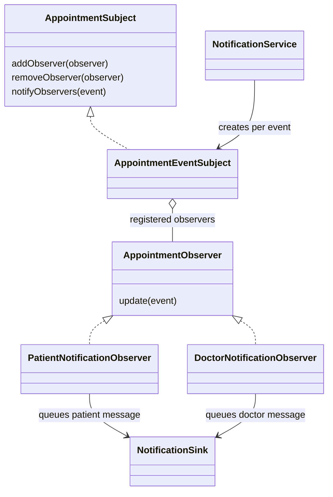
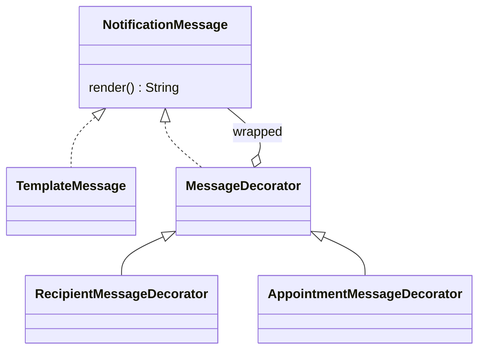
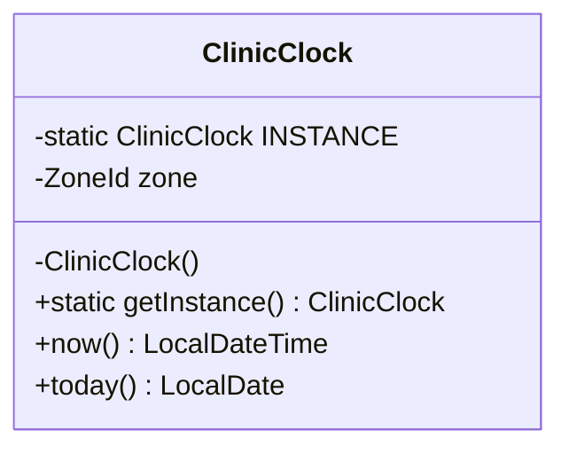

# Lecture design patterns in MediCare Pro

All five patterns from the supplied lectures are now represented in the main application (`src`).
The implementations and their verification tests are included in this repository.

| Pattern | Main classes | Actual workflow |
| --- | --- | --- |
| Singleton | `patterns/ClinicClock` | Booking availability, attendance checks, password-reset expiry and notification delivery share an immutable Asia/Colombo clock. Private constructor, static instance and `getInstance()` match the lecture structure. Eager initialization is thread-safe. |
| Observer | `AppointmentSubject`, `AppointmentEventSubject`, `AppointmentObserver`, `PatientNotificationObserver`, `DoctorNotificationObserver` | Confirmation, cancellation, rescheduling and reminder events notify registered patient/doctor observers. They write to the existing transactional notification outbox. |
| Strategy | `Payment`, `CardPayment`, `CashPayment`, `CheckoutService` | Checkout selects a payment strategy using the requested method. Card remains an explicitly enabled demo simulation; production uses counter cash. |
| Factory | `UserFactory`, `AdminController` | Account creation chooses Patient, Admin or staff User from the requested role. This is a **Simple Factory**, not subclass-based GoF Factory Method. |
| Decorator | `NotificationMessage`, `TemplateMessage`, `MessageDecorator`, `RecipientMessageDecorator`, `AppointmentMessageDecorator` | Subject/body templates are wrapped at runtime to add recipient personalization and appointment detail substitution without changing the base component. |

## Observer structure

Subscriptions are scoped to one event invocation. They are not a static/global list, so concurrent bookings cannot share patient subscriptions. Observers run synchronously in the existing transaction: a queue failure rolls back the event, and actual SMTP delivery remains outside the scheduler transaction. No second notification path is introduced.

## Decorator structure

The runtime composition is `AppointmentMessageDecorator(RecipientMessageDecorator(TemplateMessage))`. The base template stays unchanged. Existing administrator templates, patient identities, event keys and mail retry handling are retained.

## Singleton structure

The singleton stores no user, appointment, database connection or mutable request state. It is one instance per class loader, while Spring services remain container-managed beans.

## Viva explanation

- Singleton: One clinic clock provides the same Sri Lankan time source to multiple workflows.
- Observer: Appointment events notify registered patient and doctor observers; each queues its recipient's message.
- Strategy: Checkout delegates to the selected Card or Cash implementation through Payment.
- Simple Factory: UserFactory centralizes which account class is created for each role.
- Decorator: Message wrappers compose recipient personalization and appointment details around a template.

## Validation

`DesignPatternsTest` covers concurrent singleton access, observer registration/removal and request isolation, and message composition without mutating the base template. The full existing integration suite is also run to verify booking, notifications, security and billing.

Verified result: 136 tests total, 135 passed, 1 skipped (opt-in live SQL Server test), 0 failures and 0 errors. Full suite completed successfully on 11 October 2026.
