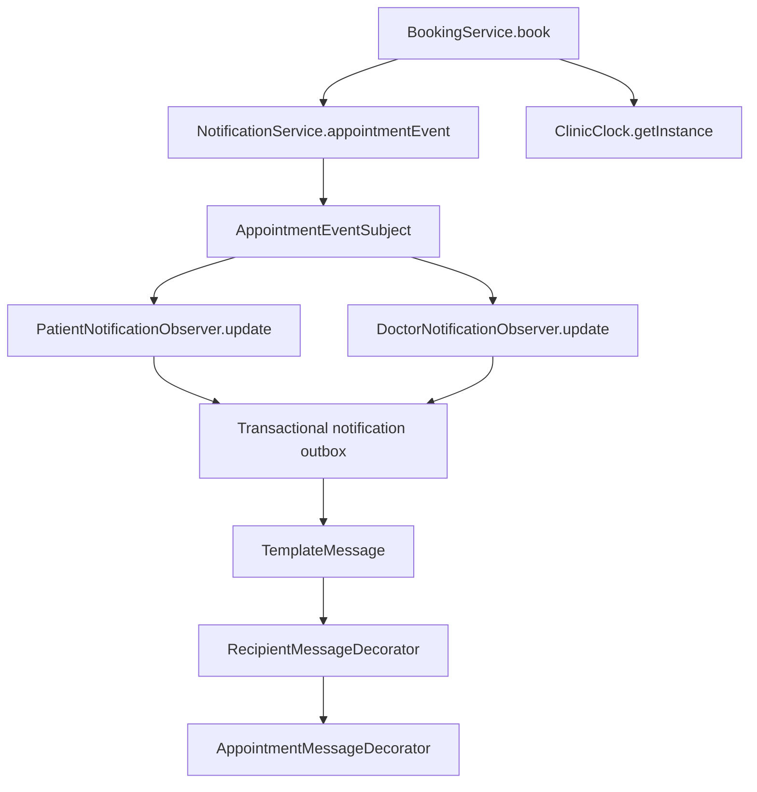

# Dhanukshan S. - Appointment Booking updates

This update is scoped to Appointment Booking and its required shared dependencies. Existing published commits and other team modules are retained. Account recovery, production configuration, the framework upgrade and separate DDD viva pages from the local workspace are not included.

## Behavior

- Self and family bookings preserve the attending patient's name and NIC separately from the account owner.
- Account, attending identity and doctor locks prevent concurrent overlapping reservations across doctors and family accounts.
- Inactive doctors are excluded from booking and branch discovery.
- The agreed consultation fee is stored as DECIMAL(19,2) on the appointment and reused at checkout/rescheduling. Existing invoice storage stays on the team's current baseline.
- Cancelled appointments are hidden from the patient's paginated history instead of deleting financial or clinical records.
- Booking carries its payment selection to checkout. Cash stays unpaid until collected; card simulation is explicitly enabled only in demo/test configuration.
- Existing safe booking error messages and role/owner checks are retained.

## Lecture design patterns

| Pattern | Code | Booking connection |
| --- | --- | --- |
| Singleton | `patterns/ClinicClock.java` | Private constructor, static instance, `getInstance()`; Sri Lanka time for booking availability and appointment date checks. |
| Observer | `patterns/observer/*` and `NotificationService.appointmentEvent()` | A per-event subject registers patient and doctor observers, then invokes `update()` to queue transactional notifications. |
| Decorator | `patterns/decorator/*` and `NotificationService.render()` | Recipient and appointment wrappers compose personalization around an unchanged message template. |
| Strategy (existing) | `Payment`, `CardPayment`, `CashPayment`, `CheckoutService` | Selected payment behavior is delegated through the common interface. |
| Simple Factory (existing) | `UserFactory`, `AdminController` | Account objects are created according to role; this is not subclass-based Factory Method. |

For viva: show `BookingService.book()` first, then `NotificationService.appointmentEvent()`, then the two observers. For Singleton show the private constructor, static instance and `getInstance()`. For Decorator show the two wrappers created in `render()`.

## Existing databases

`database/appointment-updates-sqlserver.sql` adds the appointment columns and attendee-lock table without changing account identities. Development schema update can also add these fields. Historical invoice values are preferred when backfilling the agreed fee; otherwise only the current doctor fee is available. Previously lost family details cannot be recovered automatically. This release does not apply the broader V003 account/production migration.

## Validation

The GitHub checkout's own framework baseline is tested independently; the local workspace's 136-test result is not claimed as validation for this branch. Live SQL Server smoke coverage remains opt-in.

Latest reports across all 13 suites: **111 tests, 110 passed, 1 skipped**, 0 failures and 0 errors. The initial full run caught one obsolete deletion expectation; it was replaced with assertions that cancellation/archive retains the appointment and notifications while removing it from patient history. All 18 tests in the follow-up appointment/pattern/portal run passed, including the six new appointment regressions. SQL Server smoke testing was not enabled and no live migration was applied.
